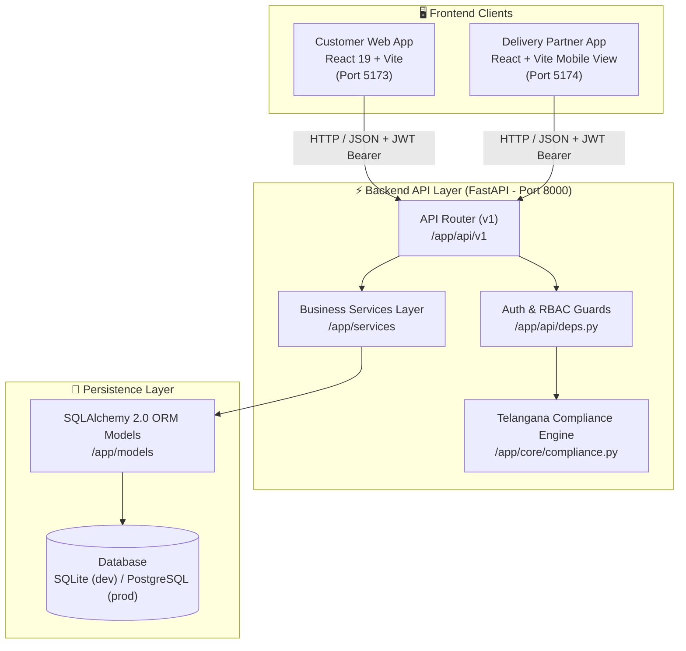
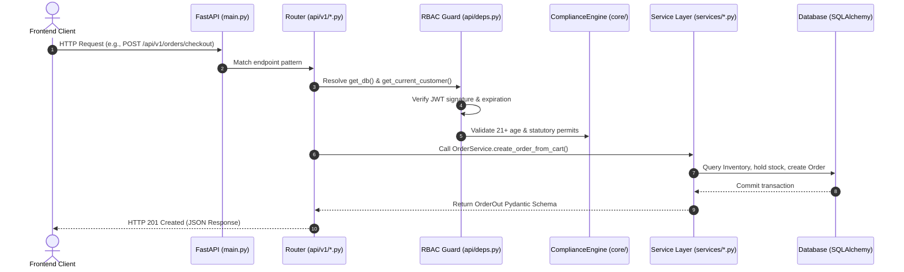
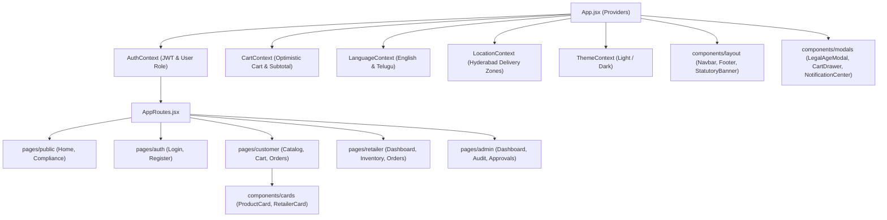

# 🏛️ AlcoRez Architecture & Developer Onboarding Guide

Welcome to **AlcoRez**! This guide is designed to help any engineer—whether junior, fresher, or senior—understand the architecture, directory structure, data flows, and design patterns of this repository in minutes.

---

## 1. High-Level System Overview

AlcoRez is a state-regulated alcohol discovery, retail inventory management, and simulated order reservation platform tailored for the state of **Telangana, India**.

Under the **Telangana Excise Act, 1968**, commercial alcohol sales and delivery are strictly regulated. The platform implements a **fail-closed architectural posture** (live alcohol delivery and online payments default to disabled, operating in catalog discovery and simulated demonstration mode).

### System Topology



---

## 2. Directory Layout & Folder Separation

The project enforces clean separation of concerns. Below is the full folder breakdown:

```
AlcoRez/
├── backend/                         # 🐍 Python FastAPI REST API Backend
│   ├── alembic/                     # Database schema migrations
│   │   └── versions/                # Versioned SQL migration scripts
│   ├── app/                         # Application core package
│   │   ├── api/                     # HTTP routing & dependencies
│   │   │   ├── v1/                  # API v1 route controllers
│   │   │   └── deps.py              # Dependency injection (DB session, RBAC auth)
│   │   ├── core/                    # Infrastructure configs, security & compliance
│   │   │   ├── compliance.py        # Statutory fail-closed legal checks
│   │   │   ├── config.py            # Environment settings (Pydantic BaseSettings)
│   │   │   ├── database.py          # SQLAlchemy engine & session factory
│   │   │   └── security.py          # JWT tokens & bcrypt password hashing
│   │   ├── models/                  # SQLAlchemy 2.0 ORM database tables
│   │   ├── schemas/                 # Pydantic v2 validation DTOs (Request/Response)
│   │   ├── services/                # Pure business logic & database transactions
│   │   └── main.py                  # FastAPI application entry point & middlewares
│   ├── scripts/                     # Standalone CLI tools & database seeders
│   │   ├── seed_data.py             # Telangana catalog & mock stores seeder
│   │   └── bootstrap_admin.py       # First-time Super Admin account provisioning
│   ├── Dockerfile                   # Production container definition
│   ├── requirements.txt             # Pinned Python package dependencies
│   └── alembic.ini                  # Alembic migration configuration
│
├── frontend/                        # ⚛️ React 19 + Tailwind CSS Frontend
│   ├── public/                      # Static assets, logos, excise icons
│   ├── src/
│   │   ├── components/              # Reusable UI component library
│   │   │   ├── layout/              # Structural chrome (Navbar, Footer, Banners)
│   │   │   ├── cards/               # Presentational cards (ProductCard, RetailerCard)
│   │   │   ├── modals/              # Overlays (LegalAgeModal, CartDrawer, Notifications)
│   │   │   └── index.js             # Centralized components barrel export
│   │   ├── context/                 # Global state providers (Auth, Cart, Language, Theme, Location)
│   │   ├── pages/                   # Route views grouped by role & domain
│   │   │   ├── public/              # Informational pages (Home, Compliance info)
│   │   │   ├── auth/                # Login & Customer Registration
│   │   │   ├── customer/            # Catalog, Product Detail, Cart, Orders, Checkout
│   │   │   ├── retailer/            # Retailer Portal (Dashboard, Inventory, Store Orders)
│   │   │   ├── admin/               # Excise Admin Portal (Approvals, Retailers, Audit Logs)
│   │   │   └── index.js             # Centralized pages barrel export
│   │   ├── routes/                  # React Router declarations (AppRoutes.jsx)
│   │   ├── services/                # HTTP API Client & caching (api.js)
│   │   ├── utils/                   # Helpers (image sizing, formatting)
│   │   ├── App.jsx                  # Root layout, providers, global modals
│   │   ├── main.jsx                 # Vite application mount
│   │   └── index.css                # Tailwind CSS v4 styling & theme tokens
│   ├── package.json
│   └── vite.config.js
│
├── ARCHITECTURE.md                  # 📖 This architecture & onboarding guide
├── README.md                        # Project summary & setup instructions
├── pyproject.toml                   # Ruff linter, Pytest & Pyrefly configurations
└── docker-compose.yml               # Multi-container orchestration (PostgreSQL + Backend)
```

---

## 3. Backend Architecture: Request Lifecycle

When a request reaches the backend, it flows strictly through a 5-layer pipeline:



### Why this separation matters:
1. **Routers (`api/v1/`)**: Only handle HTTP status codes, query/path parameters, and call services. No direct database queries belong here.
2. **Services (`services/`)**: Pure Python classes containing business rules, multi-table transactions, stock calculations, and audit logging.
3. **Models (`models/`)**: Pure SQLAlchemy table mappings with foreign keys and relationships.
4. **Schemas (`schemas/`)**: Pydantic models ensuring strict type safety and request/response serialization.
5. **Core (`core/`)**: Cross-cutting concerns—database connections, JWT encryption, legal compliance gates.

---

## 4. Frontend Architecture: Component & State Hierarchy



### Key Frontend Patterns:
- **Role-Based Views**: Features adapt seamlessly based on `role` (`customer`, `retailer`, `admin`, `delivery_partner`).
- **Optimistic Cart UI**: Adding or modifying items in `CartContext` updates the screen instantly (0ms) while synchronizing with the backend in the background. If the server rejects the request, the state rolls back automatically.
- **Bilingual Internationalization**: Instant English ↔ Telugu switching across all product categories, legal disclaimers, and order statuses without full-page reloads.

---

## 5. Fresher Cookbook: "How To" Guide

### How to Add a New API Feature (Example: Product Reviews)

1. **Create the Model** in `backend/app/models/review.py`:
   - Inherit from `TimeStampedUUIDModel`.
   - Add foreign keys to `User.id` and `Product.id`.
   - Register it in `backend/app/models/__init__.py`.
2. **Define Pydantic Schemas** in `backend/app/schemas/review.py`:
   - `ReviewCreate(BaseModel)` for incoming payloads.
   - `ReviewOut(BaseModel)` for JSON responses (`from_attributes = True`).
   - Re-export in `backend/app/schemas/__init__.py`.
3. **Write the Service** in `backend/app/services/review_service.py`:
   - Implement `@staticmethod def add_review(...)`.
   - Re-export in `backend/app/services/__init__.py`.
4. **Expose the Endpoint** in `backend/app/api/v1/products.py`:
   - Add `@router.post("/{product_id}/reviews", response_model=ReviewOut)`.
   - Use `Depends(get_current_customer)` to enforce authentication.
5. **Run Linting & Validation**:
   ```bash
   ruff check backend
   ```

### How to Add a New Frontend Page

1. **Create the Page Component** in the appropriate domain folder:
   - e.g., `frontend/src/pages/customer/ReviewsPage.jsx`.
2. **Export from Domain Barrel**:
   - Add `export { default as ReviewsPage } from './ReviewsPage';` to `frontend/src/pages/customer/index.js`.
3. **Declare the Route** in `frontend/src/routes/AppRoutes.jsx`:
   ```jsx
   const ReviewsPage = lazy(() => import('../pages/customer/ReviewsPage'));
   // Inside <Routes>:
   <Route path="/reviews" element={<ReviewsPage />} />
   ```
4. **Call the API Client**:
   - Use `api.getProductReviews(id)` from `frontend/src/services/api.js`.
5. **Verify the Build**:
   ```bash
   npm --prefix frontend run build
   ```

---

## 6. Development Quickstart (Zero to Running in 2 Minutes)

### Terminal 1: Backend
```bash
cd backend
python -m venv .venv
# Windows: .venv\Scripts\activate | Unix: source .venv/bin/activate
pip install -r requirements.txt
python scripts/seed_data.py       # Seeds catalog fixtures and test accounts
uvicorn app.main:app --reload --port 8000
```
- API Documentation: [http://localhost:8000/docs](http://localhost:8000/docs)
- Health Check: [http://localhost:8000/api/v1/health](http://localhost:8000/api/v1/health)

### Terminal 2: Customer Frontend
```bash
cd frontend
npm install
npm run dev
```
- Web Application: [http://localhost:5173](http://localhost:5173)

### Pre-Configured Demo Credentials
All passwords are set to standard mock test credentials for instant evaluation:
- **Customer:** `customer@demo.com` / `Customer@123456`
- **Retailer:** `retailer@madhapurwines.mock` / `Retailer@123456`
- **Excise Admin:** `admin@telanganaliquor.gov.mock` / `Admin@123456`
- **Delivery Partner:** `partner@demo.com` / `Partner@123456`
